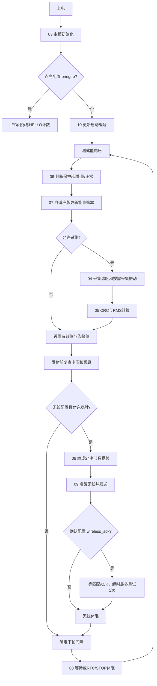
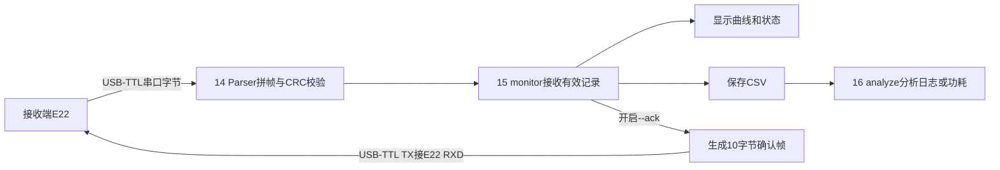

# 代码阅读地图：从上电到电脑看到数据

每个自编C/H文件顶部有中文模块标题，较长文件内部有步骤标题；Python工具也有中文标题。文件名与函数名保持工程约定，标题负责解释用途。`firmware/Drivers`保留厂家原始代码及校验值，按目录理解即可。

## 一、先认清三个运行位置

| 位置 | 运行的内容 | 从哪里开始 |
|---|---|---|
| 采集板STM32 | 读温度、振动、电压，决定任务和休眠，发无线数据 | [01 主流程 main.c](../firmware/Core/Src/main.c) |
| 电脑 | 接收、显示、回传可选确认、保存记录 | [15 上位机 monitor.py](../desktop/monitor.py) |
| 编译与测试工具 | 把源码变成固件，检查代码；平时不运行在STM32上 | [13 工程工具 project.py](../tools/project.py) |

`.c`是功能实现，`.h`是其他文件调用它的接口。`main.c`里出现`temperature_read()`，就去`sensors.c`找实现，去`sensors.h`看接口。阅读时顺着调用走，不需要先读完所有HAL驱动。

## 二、主流程图

能量预算仅在`adaptive`配置执行任务准入和周期调整。`sensors`不发射；`wireless`和`wireless_ack`用于外部供电联调；`fixed`保留电压保护与休眠但不启用预算自适应。不要把一个配置的行为当成所有配置都会执行。

## 三、STM32代码的中文标题与阅读顺序

| 编号和标题 | 实现/参数文件 | 对应接口 | 读这一部分要明白什么 |
|---|---|---|---|
| 01 主流程：上电、采集、决策、发送、休眠 | [main.c](../firmware/Core/Src/main.c) | 无 | 11个步骤如何连起来 |
| 02 参数表：引脚、阈值、周期与能耗估算 | [app_config.h](../firmware/Core/Inc/app_config.h) | 本文件 | 接线、校准和估算参数集中在哪里 |
| 03 主板服务：时钟、引脚、串口、ADC、休眠与中断 | [board.c](../firmware/Core/Src/board.c) | [board.h](../firmware/Core/Inc/board.h) | 操作芯片硬件、恢复I2C、无线中断收字节 |
| 04 传感器驱动：温度单总线与加速度I2C | [sensors.c](../firmware/Core/Src/sensors.c) | [sensors.h](../firmware/Core/Inc/sensors.h) | 怎样从传感器取得原始读数，失败怎样返回 |
| 05 数据计算：振动RMS、温度解码与电压换算 | [features.c](../firmware/Core/Src/features.c) | [features.h](../firmware/Core/Inc/features.h) | 原始数值怎样变成℃、mg和mV |
| 06 能量状态：保护、低能量、正常 | [energy_policy.c](../firmware/Core/Src/energy_policy.c) | [energy_policy.h](../firmware/Core/Inc/energy_policy.h) | 滞回如何防止状态在边界反复跳变 |
| 07 能量账本：任务准入与15至300秒调度 | [energy_budget.c](../firmware/Core/Src/energy_budget.c) | [energy_budget.h](../firmware/Core/Inc/energy_budget.h) | 电容剩余能量是否够执行任务，周期如何调整 |
| 08 无线数据格式：24字节遥测与10字节确认 | [packet.c](../firmware/Core/Src/packet.c) | [packet.h](../firmware/Core/Inc/packet.h) | 数字怎样装进帧，CRC怎样防误码 |
| 09 无线驱动：唤醒、发送、确认、有限重试、休眠 | [radio.c](../firmware/Core/Src/radio.c) | [radio.h](../firmware/Core/Inc/radio.h) | AUX完成与收到远端ACK各表示什么 |
| 10 启动记录：双页Flash与中断写入保护 | [boot_journal.c](../firmware/Core/Src/boot_journal.c) | [boot_journal.h](../firmware/Core/Inc/boot_journal.h) | 为什么重启后还能区分会话，写到一半掉电怎么办 |
| 11 标准库支持：有界内存与文件接口占位 | [syscalls.c](../firmware/Core/Src/syscalls.c) | 标准库接口 | 芯片没有电脑文件系统，库函数需要哪些底层支持 |
| 12 HAL配置：启用哪些芯片外设 | [stm32f1xx_hal_conf.h](../firmware/Core/Inc/stm32f1xx_hal_conf.h) | 本文件 | 外设驱动开关和时钟标称值 |

第一次阅读建议：**01 → 02 → 04 → 05 → 06 → 07 → 08 → 09 → 03 → 10**。先知道每轮做什么，再追进具体硬件接口。

## 四、电脑端流程

| 编号和标题 | 文件 | 用途 |
|---|---|---|
| 13 工程工具：找工具链、编译、烧录与F5设置 | [tools/project.py](../tools/project.py) | setup/build/flash命令入口 |
| 14 电脑端协议：遥测解码、确认帧和串口分片恢复 | [desktop/protocol.py](../desktop/protocol.py) | 和STM32的packet.c保持同一种格式 |
| 15 电脑上位机：接收、可选确认、显示、记录 | [desktop/monitor.py](../desktop/monitor.py) | 真串口与演示模式分开；确认版加--ack |
| 16 记录分析：有效数据、序号缺口和实测功耗积分 | [desktop/analyze.py](../desktop/analyze.py) | 只根据输入CSV计算，演示日志默认拒绝当实测 |
| 17 DeepSeek助手：预览指定代码，再显式发送复核 | [desktop/deepseek_review.py](../desktop/deepseek_review.py) | 开发辅助；不参与MCU实时控制 |
| 18 电脑协议自检：无需串口、传感器或密钥 | [desktop/selftest.py](../desktop/selftest.py) | 最先运行的电脑检查 |
| 19 ARM核心与无线驱动测试 | [tests/test_core.c](../tests/test_core.c)、[tests/run_core.py](../tests/run_core.py)、[测试内存布局](../tests/test_flash.ld) | 运行实际交叉编译的C指令 |
| 19 测试替身：可控时间、GPIO与UART | [tests/fakes/board.h](../tests/fakes/board.h)、[tests/fakes/radio_hal.c](../tests/fakes/radio_hal.c) | 在电脑模拟ACK、UART失败、AUX超时，不是实物HAL |
| 20 电脑端测试：日志、功耗、串口闭环与压力测试 | [test_desktop.py](../tests/test_desktop.py)、[test_monitor.py](../tests/test_monitor.py)、[test_protocol.py](../tests/test_protocol.py) | 检查序号回卷、坏帧、分片、ACK和CSV |
| 无硬件总验收 | [tools/check.py](../tools/check.py) | 一条命令组合已有检查；--build再编译六配置 |
| 固件打包 | [tools/release.py](../tools/release.py) | 更新预编译文件、源码和固件校验值 |
| 电脑依赖 / 测试依赖 | [desktop/requirements.txt](../desktop/requirements.txt)、[tests/requirements.txt](../tests/requirements.txt) | pyserial用于真实串口；Unicorn只用于ARM测试 |

## 五、构建、第三方驱动和模型各是什么

| 标题 | 文件或目录 | 作用 |
|---|---|---|
| 21 构建清单 | [CMakeLists.txt](../CMakeLists.txt) | 六个配置决定编哪些功能和源文件 |
| 22 交叉编译工具链 | [cmake/arm-gcc.cmake](../cmake/arm-gcc.cmake) | 使用Arm编译器，而非电脑C程序编译器 |
| 23 芯片内存布局 | [STM32F103C8Tx_FLASH.ld](../firmware/STM32F103C8Tx_FLASH.ld) | 程序62KiB，启动记录预留2KiB；RAM20KiB |
| 六配置快捷选择 | [CMakePresets.json](../CMakePresets.json) | 带中文displayName，内部英文名与命令一致 |
| VS Code编译和烧录任务 | [tasks.json](../.vscode/tasks.json) | Build/Flash任务有中文detail，F5引用名称保持一致 |
| VS Code编辑器设置与扩展推荐 | [settings.json](../.vscode/settings.json)、[extensions.json](../.vscode/extensions.json) | 头文件识别、编译数据库、扩展安装提示 |
| 本机F5配置 | `.vscode/launch.json` | setup在你自己电脑生成，不上传本机工具绝对路径 |
| ST外设驱动HAL | [firmware/Drivers/STM32F1xx_HAL_Driver](../firmware/Drivers/STM32F1xx_HAL_Driver) | 厂家操作寄存器的基础代码；应用通过HAL调用 |
| ARM内核支持CMSIS | [firmware/Drivers/CMSIS/Core](../firmware/Drivers/CMSIS/Core) | Cortex-M3内核定义、编译器支持 |
| F103芯片定义和上电启动 | [firmware/Drivers/CMSIS/Device/ST/STM32F1xx](../firmware/Drivers/CMSIS/Device/ST/STM32F1xx) | 启动文件先准备内存，再调用main |
| 第三方来源与校验表 | [DEPENDENCIES.json](../DEPENDENCIES.json) | 固定提交、文件SHA256，避免混用库版本 |
| 可烧录结果 | [releases](../releases) | 六配置HEX、BIN与符号ELF；程序源文件不在这里改 |
| 构建与核心测试记录 | [BUILD_INFO.json](../releases/BUILD_INFO.json)、[CORE_TEST_RESULT.json](../releases/CORE_TEST_RESULT.json) | 文件哈希、软件检查范围和未验证项目 |
| 24 三维结构与能量演示 | [3D动态结构模型.html](3D动态结构模型.html) | 浏览器交互概念，不是物理仿真结果 |
| 25 可修改结构草模 | [结构草模.scad](结构草模.scad) | 用OpenSCAD修改占位尺寸，实物测量后再定稿 |
| 工程使用说明 | [README.md](../README.md) | 安装、接线、运行、排错 |
| 软件验收与实机待办 | [无硬件验收与实机待办.md](无硬件验收与实机待办.md) | 分清电脑上能验证什么、板子到了还要测什么 |
| 版本忽略与许可 | [.gitignore](../.gitignore)、[LICENSE.md](../LICENSE.md) | 排除缓存、日志、本机配置和密钥文件；保留第三方许可 |

## 六、要改某个行为，去哪个文件

| 想做的事 | 先看 |
|---|---|
| 换引脚、修改阈值、修改估算电容/耗能 | 02 app_config.h，然后同步接线和校准记录 |
| 调整一轮工作的先后顺序 | 01 main.c |
| 读取失败、I2C锁死 | 04 sensors.c及03 board.c |
| 调整电压分档逻辑 | 06 energy_policy.c |
| 让周期随可用能量改变 | 07 energy_budget.c |
| 确认数据有没有收到、重试多少次 | 09 radio.c、02参数、15上位机--ack |
| 修改字段或协议 | 08 packet.c/.h与14 protocol.py一起改，再跑测试 |
| 修改界面与CSV展示 | 15 monitor.py；保持有效位与来源标识 |
| 更新可下载固件 | check.py --build通过后运行release.py，再提交源码和releases |

新队友第一次同步：`git clone`后先读本文件，再按README运行`bringup`。后续先保存自己的修改，再执行`git fetch origin`与`git pull --ff-only origin main`。

## 七、电路原理图

[hardware/README.md](../hardware/README.md)是硬件入口：01主板与调试、02温度/振动/ADC、03无线收发、04LDO/电源选择与待定取电边界。PDF看图，SVG可改图，Connections.csv对照逻辑引脚。没有EDA/ERC/PCB验证。
